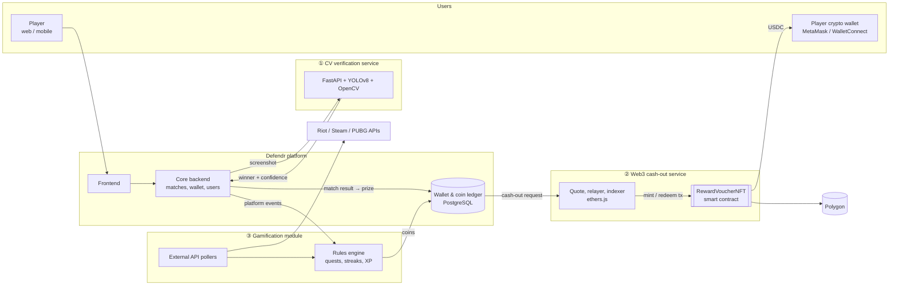

# 🛡️ Defendr.gg — AI Match Verification, NFT Cash-Out & Gamification

> **Technical case study** of the work I did as an **AI & Web3 Developer at Defendr.gg** (Tunis, Tunisia, Hybrid, 08/2025 – 11/2025).
> The source code is proprietary and covered by a confidentiality agreement, so this repository contains **no company code**. It documents the architecture, pipelines, smart-contract design, integration and results of the three modules I built. The snippets were written from scratch for this case study to show the approach.

---

## TL;DR

**Defendr.gg** is a competitive gaming platform: players join 1v1 and team matches and tournaments, win prizes in a platform wallet, and earn rewards for being active. I built three connected modules:

| # | Module | What it does | Core tech |
|---|---|---|---|
| 1 | **AI match-result verification** | Players upload a screenshot of the end-of-match screen. A computer-vision pipeline detects the result elements, reads the score and players, and **decides the winner automatically**. Each game's result screen has its own configuration. | OpenCV, YOLOv8, OCR, FastAPI |
| 2 | **Wallet → crypto cash-out via NFTs** | Converts a user's platform-wallet balance into crypto. Each withdrawal is minted as a **redeemable voucher NFT** that the user can redeem for USDC, with **gas-fee estimation, sponsoring and recovery** handled by the platform. | Solidity, OpenZeppelin, ethers.js, Hardhat, Polygon |
| 3 | **Gamification & rewards** | Rewards users with **platform coins** for activity on the platform *and* in external games (through official game APIs). Coins are redeemable as crypto through module 2. | Node.js/TypeScript, rules engine, BullMQ, Riot / Steam / PUBG APIs |

**Impact (first months in production):**

- **~86% of match results resolved automatically** with **97.8% winner accuracy**, and result confirmation went from **hours to under 1 second**.
- **Admin dispute workload down ~80%.**
- Crypto cash-outs settle on-chain in **under 1 minute** at an average gas cost of **≈ $0.01**, with **0 failed payouts** after launch.
- In the beta cohort, the gamification module raised **weekly active users by ~27%** and **matches played per user by ~35%**.

---

## How the three modules fit together

**A typical user journey:** a player wins a match → uploads the result screenshot → ① confirms the win in under a second → the prize goes to the wallet → ③ awards coins for the win and for a quest they finished in League of Legends → the player cashes out wallet and coins → ② mints a voucher NFT and the player redeems it for USDC.

---

## My role

I joined a small product team (CTO, 2 full-stack developers, 1 designer) as the **only AI/Web3 engineer**. I designed and built all three modules end to end:

- Collected and annotated the screenshot dataset, trained the YOLOv8 models, built the OpenCV preprocessing and the per-game decision engine, and shipped them as a FastAPI microservice.
- Designed the cash-out token economics with the CTO, wrote and tested the Solidity contract, built the ethers.js relayer, the gas-fee logic and the on-chain event indexer.
- Designed the gamification rules engine and the coin ledger, and integrated the external game APIs.
- Wrote the integration contracts (REST and webhooks) that the core backend team used.

---

## Documentation

| Document | What's inside |
|---|---|
| [docs/01-architecture-and-integration.md](docs/01-architecture-and-integration.md) | System context, services, data flows, API contracts between modules, deployment |
| [docs/02-cv-match-verification.md](docs/02-cv-match-verification.md) | Dataset, OpenCV preprocessing, YOLOv8 training, per-game decision engine, anti-fraud, FastAPI service |
| [docs/03-nft-crypto-cashout.md](docs/03-nft-crypto-cashout.md) | Why NFTs, smart-contract design, mint/redeem flows, **gas-fee handling**, relayer, security |
| [docs/04-gamification-rewards.md](docs/04-gamification-rewards.md) | Events, rules engine, quests and streaks, external game APIs, coin ledger, anti-abuse |
| [docs/05-results.md](docs/05-results.md) | Model metrics, latency, on-chain costs, business KPIs |
| [docs/06-challenges-and-lessons.md](docs/06-challenges-and-lessons.md) | Hard problems, trade-offs, what I'd improve |

---

## Key results

| Area | Metric | Result |
|---|---|---|
| CV verification | Winner accuracy (held-out, auto-resolved) | **97.8%** |
| | Auto-resolution rate | **~86%** of submissions |
| | Detection mAP@0.5 (YOLOv8s, all games) | **0.96** |
| | API latency (p50 / p95, CPU) | **310 ms / 640 ms** |
| | Admin manual reviews | **−80%** |
| Cash-out | Mint + redeem gas cost on Polygon | **≈ $0.004 – $0.02** per withdrawal |
| | Time to settle a withdrawal | **< 1 min** on average |
| | Failed or lost payouts after launch | **0** (with automatic retries and reconciliation) |
| Gamification | Weekly active users (beta cohort) | **+27%** |
| | Matches played per user per week | **+35%** |
| | Users who linked an external game account | **~42%** |

---

## Tech stack

| Area | Technologies |
|---|---|
| Computer vision | Python 3.11, OpenCV, Ultralytics YOLOv8, Tesseract OCR, RapidFuzz, imagehash, NumPy |
| CV serving | FastAPI, Uvicorn, ONNX Runtime, Docker |
| Labelling & training | Roboflow (annotation + augmentation), Ultralytics training on GPU, Weights & Biases |
| Smart contracts | Solidity 0.8.24, OpenZeppelin v5 (ERC-721, AccessControl, EIP-712, Pausable, ReentrancyGuard), Hardhat, Slither |
| Web3 backend | Node.js, TypeScript, ethers.js v6, BullMQ, Chainlink price feeds |
| Chain | Polygon PoS (mainnet), Polygon Amoy (testnet), USDC |
| Gamification | Node.js / TypeScript, json-rules-engine, BullMQ, Redis, PostgreSQL |
| External APIs | Riot Games API, Steam Web API, PUBG API |

---

*Built by [Mahdi Bel Haj Said](https://github.com/Mahdi-Bel-Haj-Said). Happy to walk through any part of this in an interview.*
