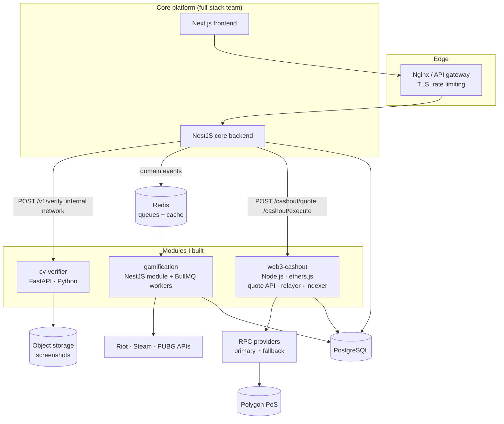

# 01 · Architecture & Integration

## System context

Defendr's core platform (users, matches, tournaments, wallet) was built by the full-stack team as a **Node.js / NestJS backend + Next.js frontend + PostgreSQL**. My three modules plug into it as separate services, behind clear contracts, so each one can be deployed, scaled and rolled back on its own.



## Integration contracts

### 1. Core backend → CV verifier (synchronous REST)

```http
POST /v1/verify            (internal only, mTLS / shared service token)
Content-Type: multipart/form-data

image=<file>  match_id=...  game_id=efootball  submitter_id=...  expected_players=["neo_tn","sk4ndar"]
```

```json
{
  "status": "auto_resolved",            // auto_resolved | needs_review | rejected
  "winner": "neo_tn",
  "score": { "neo_tn": 3, "sk4ndar": 1 },
  "confidence": 0.962,
  "reasons": [],
  "detections": [ { "cls": "score_home", "conf": 0.98, "box": [412, 88, 470, 140] } ],
  "evidence_url": "https://…/annotated/…jpg",
  "model_version": "efootball-yolov8s-v7"
}
```

When the result is `needs_review`, the backend puts the match in the admin queue with the **annotated evidence image**, so a human decides in seconds instead of searching.

### 2. Core backend → Gamification (asynchronous events)

The core backend publishes domain events to a Redis-backed BullMQ queue. The gamification workers consume them **at least once** and process them **idempotently** (deduplicated by `event_id`).

```json
{ "event_id": "evt_01J…", "type": "match.won", "user_id": "u_123",
  "occurred_at": "2025-10-04T19:22:11Z",
  "payload": { "match_id": "m_987", "game_id": "valorant", "stake": 5.0, "mode": "1v1" } }
```

Event types: `user.daily_login`, `user.profile_completed`, `user.referral_completed`, `match.played`, `match.won`, `tournament.joined`, `tournament.placed`, `wallet.first_deposit`.

### 3. Core backend → Web3 cash-out (REST + webhooks)

| Call | Purpose |
|---|---|
| `POST /cashout/quote` | Returns `{gross, platform_fee, gas_fee, net_usdc, expires_at}`, valid 60 s |
| `POST /cashout/execute` | Takes `quote_id` + `idempotency_key`, locks the balance and starts minting |
| `GET /cashout/{id}` | Status: `LOCKED → MINT_SUBMITTED → MINTED → REDEEMED`, or `FAILED → REFUNDED` |
| Webhook `cashout.status_changed` | Pushed to the core backend for user notifications |

## Shared principles

- **The ledger is the source of truth.** Every balance change (prize, coin reward, cash-out lock, refund) is an append-only ledger entry with a unique source reference. Balances are never updated in place without a matching entry.
- **Idempotency everywhere.** Screenshot verification by `(match_id, submitter_id, image_hash)`, rewards by `event_id`, cash-outs by `idempotency_key` and on-chain `withdrawalId`.
- **Fail safe, not fail open.** If the CV model is unsure, a human decides. If a transaction fails, the balance is refunded. If an external API is down, rewards are delayed, never duplicated.

## Deployment

- All services in **Docker**. The CV service image includes the exported **ONNX** models (no PyTorch at runtime), which cut the image from ~6 GB to ~900 MB and CPU latency by ~35%.
- CV verifier: 2 replicas behind the internal load balancer, scaled on CPU.
- Web3 relayer: a **single active instance** (to keep nonces ordered) with a standby. Its hot-wallet key is stored in the cloud secret manager and only loaded into memory.
- Environments: `dev` (Hardhat local chain), `staging` (Polygon Amoy testnet + test USDC), `prod` (Polygon mainnet).
- CI (GitHub Actions): lint + tests for every service, Hardhat tests + Slither for contracts, and a model regression test on a frozen screenshot set. The build fails if winner accuracy drops by more than 0.5 points.
