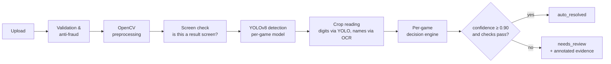

# 02 · AI Match-Result Verification (Computer Vision)

## The problem

After each match, both players had to report the result. When they disagreed, or one of them didn't report, an **admin had to check the screenshots manually**. That took **2–6 hours** on average during busy evenings. Prizes were stuck in the meantime, users complained, and it opened the door to fake results.

**Goal:** read the end-of-match screenshot automatically, decide the winner with a confidence score, and send only the unclear cases to a human.

## Supported games & result-screen families

Each game shows its result differently, so I grouped them into **three decision families**. Each game has its own YAML configuration inside its family:

| Family | Games (at launch) | How the winner is decided |
|---|---|---|
| **Score-based** | eFootball, EA SPORTS FC | Read both scores and both player names → higher score wins (penalties handled as a separate field) |
| **Banner-based** | Valorant, League of Legends | Detect the `VICTORY` / `DEFEAT` banner + identify whose screen it is, cross-checked with the round score when it is visible |
| **Placement-based** | PUBG Mobile | Detect the placement (`#1`, "WINNER WINNER CHICKEN DINNER") and the player's name / team |

## Pipeline



### 1. Validation & anti-fraud

- File checks: type (JPEG/PNG/HEIC), size ≤ 10 MB, minimum resolution 640 px on the short side.
- **Perceptual hash (pHash)** compared with all previous submissions for the same game. A Hamming distance ≤ 6 means the screenshot was **reused from an older match**, and the submission is rejected.
- EXIF checks when metadata exists (capture time vs. match time, editing software tag). These are **soft signals** that lower confidence and never reject on their own.
- Both players' submissions for the same match are compared (see consensus below).

### 2. OpenCV preprocessing

Users upload everything from clean in-game screenshots to **phone photos of a TV**, so preprocessing mattered a lot:

| Step | Technique | Why |
|---|---|---|
| Orientation | EXIF transpose + aspect-ratio rotation | Phone photos often come rotated |
| **Screen rectification** | Canny edges → largest 4-point contour (`approxPolyDP`) → `getPerspectiveTransform` / `warpPerspective` | Photos of a TV/monitor taken at an angle |
| Glare & contrast | CLAHE on the L channel (LAB colour space) | Reflections and dark rooms |
| Denoise | `fastNlMeansDenoisingColored` (only for photos, detected by moiré/blur score) | Moiré patterns from screen photos |
| Blur check | Variance of Laplacian < threshold → `needs_review: too_blurry` | Don't guess on unreadable images |
| Resize | Letterbox to 640×640 for YOLO, full-res kept for crops | Accurate small text crops |

```python
# Illustrative snippet, written for this case study
import cv2, numpy as np

def rectify_screen(img: np.ndarray) -> np.ndarray:
    """Find the screen in a photo of a monitor/TV and warp it to a flat rectangle."""
    gray = cv2.cvtColor(img, cv2.COLOR_BGR2GRAY)
    edges = cv2.Canny(cv2.GaussianBlur(gray, (5, 5), 0), 50, 150)
    cnts, _ = cv2.findContours(edges, cv2.RETR_EXTERNAL, cv2.CHAIN_APPROX_SIMPLE)
    for c in sorted(cnts, key=cv2.contourArea, reverse=True)[:5]:
        approx = cv2.approxPolyDP(c, 0.02 * cv2.arcLength(c, True), True)
        if len(approx) == 4 and cv2.contourArea(approx) > 0.3 * img.shape[0] * img.shape[1]:
            src = order_corners(approx.reshape(4, 2).astype(np.float32))
            w, h = 1920, 1080
            dst = np.float32([[0, 0], [w, 0], [w, h], [0, h]])
            return cv2.warpPerspective(img, cv2.getPerspectiveTransform(src, dst), (w, h))
    return img  # already a clean screenshot

def enhance(img: np.ndarray) -> np.ndarray:
    l, a, b = cv2.split(cv2.cvtColor(img, cv2.COLOR_BGR2LAB))
    l = cv2.createCLAHE(clipLimit=2.0, tileGridSize=(8, 8)).apply(l)
    return cv2.cvtColor(cv2.merge((l, a, b)), cv2.COLOR_LAB2BGR)
```

### 3. Is this even a result screen?

A lightweight **YOLOv8n-cls** classifier (`result_screen` vs. `other`) rejects lobby screenshots, memes, wrong games and in-match screenshots before detection. It also checks that the screenshot matches the match's `game_id`. Accuracy: **99.3%**.

### 4. YOLOv8 detection

**One YOLOv8s detection model per game family**, fine-tuned from COCO weights. The classes are the elements of the result screen:

| Family | Example classes |
|---|---|
| Score-based | `scoreboard`, `score_home`, `score_away`, `name_home`, `name_away`, `penalty_score`, `full_time_label` |
| Banner-based | `banner_victory`, `banner_defeat`, `round_score`, `player_row_self` (the highlighted row), `player_name` |
| Placement-based | `placement_number`, `chicken_dinner_banner`, `team_name`, `player_name` |
| Shared | `digit_0` … `digit_9` (game fonts are stylized, and detecting digits as objects was far more robust than OCR) |

**Dataset:**

- **~5,200 screenshots** in total: ~3,400 **historical submissions** already resolved by admins (so the labels came with a known winner) + ~1,800 I captured myself or collected from the community to cover rare layouts, languages and UI updates.
- Annotated in **Roboflow** (~41,000 bounding boxes).
- Split 70 / 15 / 15, **stratified by game and by source (clean screenshot vs. phone photo)**.
- Augmentations: perspective warp, motion blur, JPEG compression (quality 30–90), brightness/contrast, synthetic glare, moiré overlay, and *no* horizontal flip (it mirrors text and swaps home/away).

**Training:** Ultralytics YOLOv8s, 640 px, 120 epochs, early stopping, tracked in Weights & Biases. Exported to **ONNX** for CPU inference.

### 5. Reading the crops

- **Digits:** the detected `digit_*` boxes inside each score region are sorted left to right → integer score.
- **Player names:** Tesseract OCR (`--psm 7`, single line) on the upscaled, binarized crop, then **fuzzy-matched with RapidFuzz** against the two expected in-game names of that match (`token_set_ratio ≥ 80`). Matching against 2 known names, not reading free text, is what made noisy OCR good enough.
- **Banner + "whose screen":** in banner games the highlighted `player_row_self` row is OCR'd and matched to tell **who took the screenshot**. A `VICTORY` from player A's screen means A wins. A `VICTORY` from B's screen means B wins.

### 6. Per-game decision engine

Each game has a YAML configuration, so supporting a new game or a UI update mostly means **new annotations + a config file, not new code**:

```yaml
# configs/games/efootball.yaml  (illustrative)
game_id: efootball
family: score_based
model: efootball-yolov8s-v7.onnx
required: [score_home, score_away, name_home, name_away]
optional: [penalty_score, full_time_label]
rules:
  - if: "penalty_score present and score_home == score_away"
    winner: "higher penalty_score"
  - if: "score_home == score_away"
    winner: draw            # handled by match rules (replay / split)
  - else: "higher score"
min_detection_conf: 0.55
auto_resolve_threshold: 0.90
```

**Confidence** = the geometric mean of the detection confidences of the required elements × the name-match score × penalty factors (blur, photo vs. screenshot, soft EXIF flags).

### 7. Two-player consensus

| Player A says | Player B says | Outcome |
|---|---|---|
| A won (conf ≥ 0.90) | A won / B lost | ✅ Auto-resolved |
| A won (conf ≥ 0.90) | no submission within 30 min | ✅ Auto-resolved (one strong proof is enough) |
| A won | B won | ⚠️ Dispute → admin with both annotated images |
| any conf < 0.90 | — | ⚠️ needs_review |

## The FastAPI service

- `POST /v1/verify`: the full pipeline, returns the JSON shown in [01-architecture](01-architecture-and-integration.md#1-core-backend--cv-verifier-synchronous-rest).
- `GET /v1/games`: supported games and active model versions.
- `GET /health`, `GET /metrics`: Prometheus histograms per step and counters per outcome.
- Models load **once at startup** into ONNX Runtime sessions and are reused by all requests. CPU-bound inference runs in a threadpool so the event loop isn't blocked.
- Every decision is logged with its model version, so any disputed result can be **replayed and audited** later.
- An **annotated evidence image** (boxes + labels + decision) is saved for the admin UI and for user-facing dispute explanations.

## Continuous improvement loop

Every `needs_review` case that an admin resolved went back into a **"hard examples" set**. Each month I re-annotated a sample, retrained and compared the new model against the frozen regression set before deploying. This took the auto-resolution rate from **~71% at launch to ~86%** three months later.
