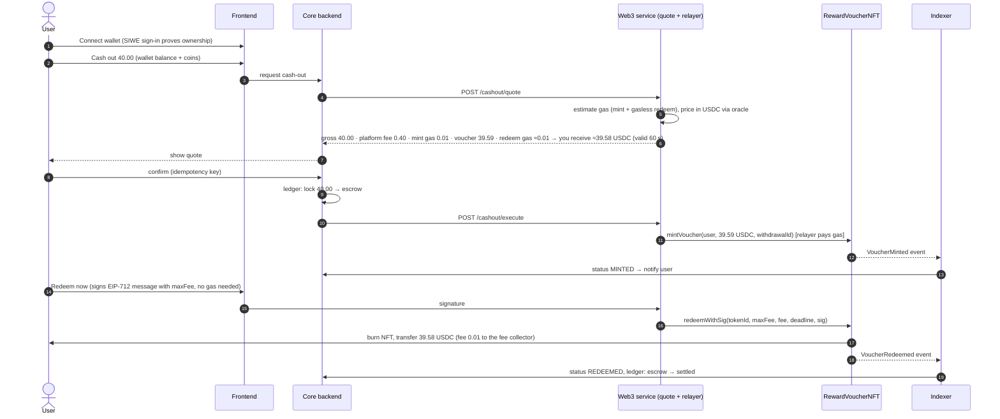
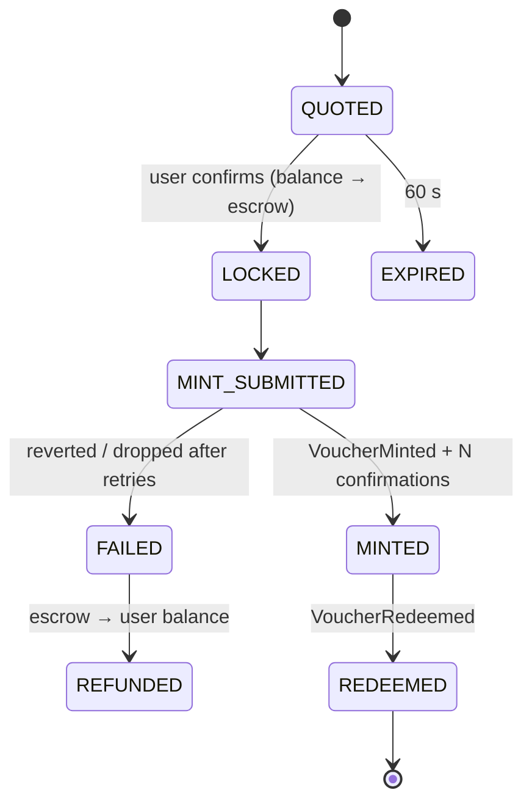

# 03 · Wallet → Crypto Cash-Out via NFTs

## The problem

Users win prizes and earn coins in an **off-chain platform wallet**. The business wanted a way to **cash out into crypto** that:

1. Is **traceable and auditable**: every withdrawal is a verifiable on-chain object.
2. Gives the user **real custody**: once issued, the value is theirs, in their own wallet.
3. **Hides blockchain complexity**: most users have never paid a gas fee, and they shouldn't need native tokens to withdraw.
4. Keeps **fees low and predictable**.

## Why NFTs?

Each withdrawal is minted as a **voucher NFT (ERC-721)** that holds a fixed USDC value and can be redeemed for that USDC at any time.

| Option | Why not / why |
|---|---|
| Direct USDC transfer from a hot wallet | Simple, but no on-chain link between a withdrawal and its platform record, and harder to audit or add rules later |
| A fungible platform token | Price volatility, liquidity and regulatory questions |
| **Voucher NFT → USDC (chosen)** | One token = one withdrawal (unique `withdrawalId`). It is auditable, can be held or transferred (gifted, used as tournament entry later), and is redeemed for a stable asset. It also opened the door to **collectible reward NFTs** (tournament badges) on the same contract family |

**Chain:** Polygon PoS. EVM-compatible, gas costs of fractions of a cent, native USDC, and wide wallet support. Everything was built and tested on **Polygon Amoy** testnet first.

## End-to-end flow



Users who know crypto can also keep the NFT and call `redeem()` themselves later, paying their own (tiny) gas.

## Smart contract

Built on **OpenZeppelin v5**: `ERC721`, `AccessControl`, `Pausable`, `ReentrancyGuard`, `EIP712`, `SafeERC20`.

```solidity
// Illustrative contract, written for this case study (simplified)
// SPDX-License-Identifier: MIT
pragma solidity ^0.8.24;

import {ERC721} from "@openzeppelin/contracts/token/ERC721/ERC721.sol";
import {AccessControl} from "@openzeppelin/contracts/access/AccessControl.sol";
import {Pausable} from "@openzeppelin/contracts/utils/Pausable.sol";
import {ReentrancyGuard} from "@openzeppelin/contracts/utils/ReentrancyGuard.sol";
import {EIP712} from "@openzeppelin/contracts/utils/cryptography/EIP712.sol";
import {ECDSA} from "@openzeppelin/contracts/utils/cryptography/ECDSA.sol";
import {IERC20} from "@openzeppelin/contracts/token/ERC20/IERC20.sol";
import {SafeERC20} from "@openzeppelin/contracts/token/ERC20/utils/SafeERC20.sol";

contract RewardVoucherNFT is ERC721, AccessControl, Pausable, ReentrancyGuard, EIP712 {
    using SafeERC20 for IERC20;

    bytes32 public constant MINTER_ROLE  = keccak256("MINTER_ROLE");   // backend relayer
    bytes32 public constant RELAYER_ROLE = keccak256("RELAYER_ROLE");  // submits gasless redeems
    bytes32 public constant PAUSER_ROLE  = keccak256("PAUSER_ROLE");
    bytes32 private constant REDEEM_TYPEHASH =
        keccak256("Redeem(uint256 tokenId,uint256 maxFee,uint256 deadline)");

    struct Voucher { uint128 amount; uint64 issuedAt; bytes32 withdrawalId; }

    IERC20  public immutable usdc;
    address public feeCollector;
    uint256 public maxVoucherAmount;          // per-withdrawal cap
    uint256 private _nextId = 1;

    mapping(uint256 => Voucher) public vouchers;
    mapping(bytes32 => bool)    public withdrawalUsed;   // one NFT per platform withdrawal

    event VoucherMinted(uint256 indexed tokenId, address indexed to, uint256 amount, bytes32 indexed withdrawalId);
    event VoucherRedeemed(uint256 indexed tokenId, address indexed holder, uint256 payout, uint256 fee);

    constructor(IERC20 usdc_, address admin, address feeCollector_, uint256 maxAmount_)
        ERC721("Defendr Reward Voucher", "DRV") EIP712("DefendrRewardVoucher", "1")
    {
        usdc = usdc_;
        feeCollector = feeCollector_;
        maxVoucherAmount = maxAmount_;
        _grantRole(DEFAULT_ADMIN_ROLE, admin);   // a Safe multisig in production
    }

    function mintVoucher(address to, uint128 amount, bytes32 withdrawalId)
        external onlyRole(MINTER_ROLE) whenNotPaused returns (uint256 tokenId)
    {
        require(amount > 0 && amount <= maxVoucherAmount, "amount");
        require(!withdrawalUsed[withdrawalId], "duplicate withdrawal");
        withdrawalUsed[withdrawalId] = true;
        tokenId = _nextId++;
        vouchers[tokenId] = Voucher(amount, uint64(block.timestamp), withdrawalId);
        _safeMint(to, tokenId);
        emit VoucherMinted(tokenId, to, amount, withdrawalId);
    }

    /// The holder redeems and pays their own gas.
    function redeem(uint256 tokenId) external nonReentrant whenNotPaused {
        require(ownerOf(tokenId) == msg.sender, "not owner");
        _settle(tokenId, msg.sender, 0);
    }

    /// Gasless redeem: the holder signs off-chain, the relayer submits and takes a fee capped by the holder.
    function redeemWithSig(uint256 tokenId, uint256 maxFee, uint256 fee, uint256 deadline, bytes calldata sig)
        external nonReentrant whenNotPaused onlyRole(RELAYER_ROLE)
    {
        require(block.timestamp <= deadline, "expired");
        require(fee <= maxFee, "fee > maxFee");
        address holder = ownerOf(tokenId);
        bytes32 digest = _hashTypedDataV4(keccak256(abi.encode(REDEEM_TYPEHASH, tokenId, maxFee, deadline)));
        require(ECDSA.recover(digest, sig) == holder, "bad signature");
        _settle(tokenId, holder, fee);         // burning the token makes the signature single-use
    }

    function _settle(uint256 tokenId, address holder, uint256 fee) private {
        Voucher memory v = vouchers[tokenId];
        require(fee < v.amount, "fee >= amount");
        delete vouchers[tokenId];
        _burn(tokenId);                                    // effects before interactions
        usdc.safeTransfer(holder, v.amount - fee);
        if (fee > 0) usdc.safeTransfer(feeCollector, fee);
        emit VoucherRedeemed(tokenId, holder, v.amount - fee, fee);
    }

    function pause() external onlyRole(PAUSER_ROLE) { _pause(); }
    function unpause() external onlyRole(PAUSER_ROLE) { _unpause(); }

    function supportsInterface(bytes4 id) public view override(ERC721, AccessControl) returns (bool) {
        return super.supportsInterface(id);
    }
}
```

The USDC that backs the vouchers sits in the contract. A treasury job tops it up from cold storage (a multisig) whenever the contract balance falls below the outstanding voucher total + a 20% buffer.

## Gas-fee handling

This was the hardest part to get right for non-crypto users. The goals were: **the user never needs POL (MATIC)**, **the platform never loses money on gas**, and **nothing gets stuck**.

### 1. Estimating and quoting

```ts
// Illustrative snippet, written for this case study (ethers v6)
import { ethers } from "ethers";

const GAS_BUFFER = 120n; // +20%

export async function quoteGasInUsdc(contract: ethers.Contract, to: string, amount: bigint, wid: string) {
  const provider = contract.runner!.provider!;
  const [mintGas, fee, polUsd] = await Promise.all([
    contract.mintVoucher.estimateGas(to, amount, wid),
    provider.getFeeData(),                       // EIP-1559: maxFeePerGas, maxPriorityFeePerGas
    readChainlinkPrice(POL_USD_FEED),            // 8 decimals
  ]);
  const REDEEM_GAS = 95_000n;                    // measured upper bound for redeemWithSig

  const toUsdc = (gas: bigint) => {
    const wei = ((gas * GAS_BUFFER) / 100n) * fee.maxFeePerGas!;
    return (wei * polUsd) / 10n ** (18n + 8n - 6n) + 1n;   // USDC has 6 decimals, round up
  };
  return {
    mintFeeUsdc: toUsdc(mintGas),                // deducted off-chain before minting
    redeemMaxFeeUsdc: toUsdc(REDEEM_GAS),        // becomes the user's signed maxFee
    maxFeePerGas: fee.maxFeePerGas!,
  };
}
```

- The quote shows the gas cost **in USDC**, already deducted from the payout. It is valid for 60 s.
- **Minimum withdrawal** (e.g. 5 USDC), so gas never takes a meaningful share of a payout.
- **Gas price ceiling:** if the network is congested above a configured `maxFeePerGas` cap, the withdrawal is queued and retried rather than overpaying. The user sees "processing" and nothing else.

### 2. Relayer: sending transactions reliably

- **One relayer wallet with a serialized queue** (BullMQ, concurrency 1) and a local **nonce manager**. Nonces never collide, even under load.
- **Stuck-transaction replacement:** if a transaction isn't mined within ~2 minutes, it is resent with the **same nonce** and fees raised by 15% (up to 3 times).
- **RPC failover:** a primary and a secondary provider (`FallbackProvider`), so one provider outage doesn't stop withdrawals.
- The **relayer balance is monitored**, with an alert when POL drops below ~3 days of average usage.

### 3. Who pays what

| Action | Gas paid by | Recovered how |
|---|---|---|
| `mintVoucher` | Platform relayer | Included in the quoted `gas_fee`, deducted from the off-chain balance before minting |
| `redeemWithSig` (gasless) | Platform relayer | The `fee` argument, capped by the user's signed `maxFee`, is taken in USDC on-chain |
| `redeem` (self) | The user | — |

## Ledger and state machine



- **Indexer:** listens to `VoucherMinted` / `VoucherRedeemed` events (WebSocket subscription + block polling as a fallback) and only updates the DB after **N confirmations** (configurable).
- **Daily reconciliation:** compares every DB withdrawal with on-chain state (`withdrawalUsed`, `ownerOf`, events). Any mismatch raises an alert. In production there were zero mismatches that needed manual action.

## Security

- **Roles:** the admin is a **Safe multisig**. `MINTER_ROLE` / `RELAYER_ROLE` belong to the hot relayer wallet, which only holds gas money and can never move the USDC reserve directly.
- **Limits:** a per-voucher cap on-chain, plus daily per-user and global caps off-chain. **KYC-verified accounts** are required above a threshold.
- **Replay protection:** EIP-712 domain (chainId + contract address), `deadline`, burn-on-redeem (single use), and the unique `withdrawalId`.
- **Circuit breaker:** `Pausable`, controlled by `PAUSER_ROLE`, plus an off-chain kill switch on the cash-out API.
- **Wallet ownership:** a **Sign-In with Ethereum (SIWE)** signature is required before an address can receive vouchers.
- **Testing:** Hardhat + Chai unit tests (**~96% line coverage**), mainnet-fork tests against real USDC, fuzz-style tests for fee and amount edge cases, and **Slither** static analysis with no high or medium findings. Before launch, the contract also went through an internal review with the CTO.
