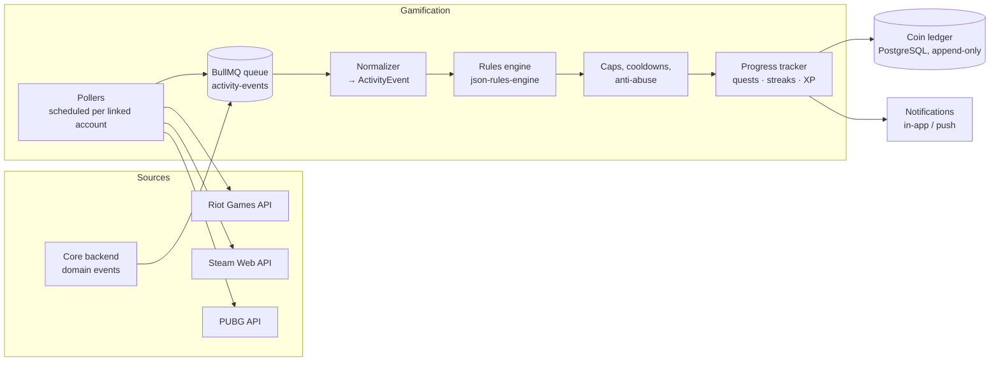

# 04 · Gamification & Rewards Module

## Goal

Keep players coming back by **rewarding activity on the platform *and* in the games they already play elsewhere**, with a currency that has real value: **coins redeemable as crypto** through the [NFT cash-out](03-nft-crypto-cashout.md).

## Concepts

| Concept | Description | Example |
|---|---|---|
| **Coins** | Platform currency earned from activity | 1,000 coins = 1 USDC at cash-out |
| **XP & levels** | Progress that never decreases and unlocks perks | Level 10 → lower cash-out fee |
| **Quests** | Daily or weekly objectives | "Win 3 Valorant matches on Defendr this week → 300 coins" |
| **External quests** | Objectives verified through game APIs | "Win 5 ranked League of Legends games → 250 coins" |
| **Streaks** | Consecutive days with activity, with a multiplier | Day 7 streak → ×1.5 on daily rewards |
| **Badges** | One-time achievements | "First tournament win" |
| **Leaderboards** | Weekly coin / XP rankings with prize pools | Top 10 split a weekly prize |

## Architecture



## 1. Activity sources

### On-platform (push)

Domain events from the core backend (`match.won`, `tournament.placed`, `user.daily_login`, `user.referral_completed`, …) arrive in the queue in real time.

### Off-platform (pull, via external game APIs)

Users **link their game accounts**, and pollers fetch their recent activity on a schedule:

| API | Linking & ownership proof | What we read |
|---|---|---|
| **Riot Games API** (League of Legends) | Riot ID → PUUID (Account-V1). Ownership proven by asking the user to **temporarily set a specific profile icon**, which we check through Summoner-V4 | Match-V5: recent matches, win/loss, queue type, duration, KDA |
| **Steam Web API** | **Steam OpenID** sign-in (ownership guaranteed by Steam) | `GetRecentlyPlayedGames`, `GetPlayerAchievements` for supported titles |
| **PUBG API** | Player name + platform, verified with a code placed in the in-game clan tag (or manual review) | Recent matches, placement, kills |

**Polling design:**

- **Adaptive schedules:** active users are polled every 15 min, inactive users every few hours, and users who opted out never.
- **Rate-limit aware:** a token bucket per API key in Redis (e.g. Riot's per-second and per-2-minute limits), and `429` responses honour `Retry-After`.
- **Incremental fetching:** only matches after the last seen match ID or timestamp are fetched.
- Every external match is normalized into the same `ActivityEvent` shape as platform events:

```json
{ "event_id": "ext:riot:EUW1_7012345678:puuid_abc", "type": "external.match.won",
  "user_id": "u_123", "game": "lol",
  "payload": { "queue": "ranked_solo", "duration_s": 1834, "kda": 4.2 } }
```

The external match ID is part of the `event_id`, so **the same game can never be rewarded twice**.

## 2. Rules engine

Rewards are **data, not code**. The product team could add or tune rules (stored as JSON in PostgreSQL, cached in Redis) without a deploy. I used **json-rules-engine**:

```json
{
  "name": "external_lol_ranked_win",
  "conditions": {
    "all": [
      { "fact": "type",  "operator": "equal", "value": "external.match.won" },
      { "fact": "game",  "operator": "equal", "value": "lol" },
      { "fact": "queue", "operator": "in",    "value": ["ranked_solo", "ranked_flex"] },
      { "fact": "duration_s", "operator": "greaterThanInclusive", "value": 900 }
    ]
  },
  "event": { "type": "reward", "params": { "coins": 40, "xp": 25, "daily_cap_key": "external", "quest_tags": ["lol_wins"] } }
}
```

Each rule's reward then goes through:

- **Caps:** daily caps per category (e.g. max 400 coins/day from external games, 600 from platform activity), so the economy stays under control.
- **Cooldowns:** e.g. daily login only once per 24 h, in the user's timezone.
- **Multipliers:** streaks, level perks and time-limited events ("double coins weekend").
- **Progress tracking:** the event also moves quest counters (`quest_tags`). Finishing a quest pays its own bonus.

## 3. Coin ledger

- An **append-only `coin_transactions` table:** `(id, user_id, amount, kind, source_event_id UNIQUE, rule_id, balance_after, created_at)`.
- The `UNIQUE(source_event_id)` constraint is the **last line of idempotency defence**, even if a worker processes the same event twice.
- Balance updates and ledger inserts run in **one database transaction** with row-level locking (`SELECT … FOR UPDATE` on the user balance), and a `CHECK (balance >= 0)` constraint.
- **Redeeming coins:** coins → wallet balance at a configured rate (1,000 coins = 1 USDC), with a minimum redemption of 5,000 coins. After that, the normal [NFT cash-out flow](03-nft-crypto-cashout.md) runs.

## 4. Anti-abuse

Coins have real value, so abuse had to be designed against from day one:

| Abuse | Defence |
|---|---|
| Linking someone else's game account | Ownership proof (profile icon / Steam OpenID / clan-tag code) |
| One game account on several platform accounts | Unique constraint on `(provider, external_account_id)` |
| Remakes, AFK or very short games | Minimum match duration + eligible queue types only |
| Farming low-effort activity | Daily caps + diminishing returns after N rewards of the same type |
| Multi-accounting / referral rings | Device and IP fingerprint heuristics on referrals; rewards paid only after the referred user's first verified match |
| Abnormal earning speed | Nightly job computing a **z-score** of each user's earning rate vs. their cohort. Above 3σ, coins are frozen and the account is reviewed |

## 5. What users see

- A **progress hub** with active quests and progress bars, streak flame, level, badges and the weekly leaderboard.
- **Real-time toasts** when coins are earned ("+40 coins: ranked win on LoL").
- A **coin history** page that reads directly from the ledger, with every entry linked to its source (match, quest, rule). This transparency cut "where are my coins?" support tickets.
